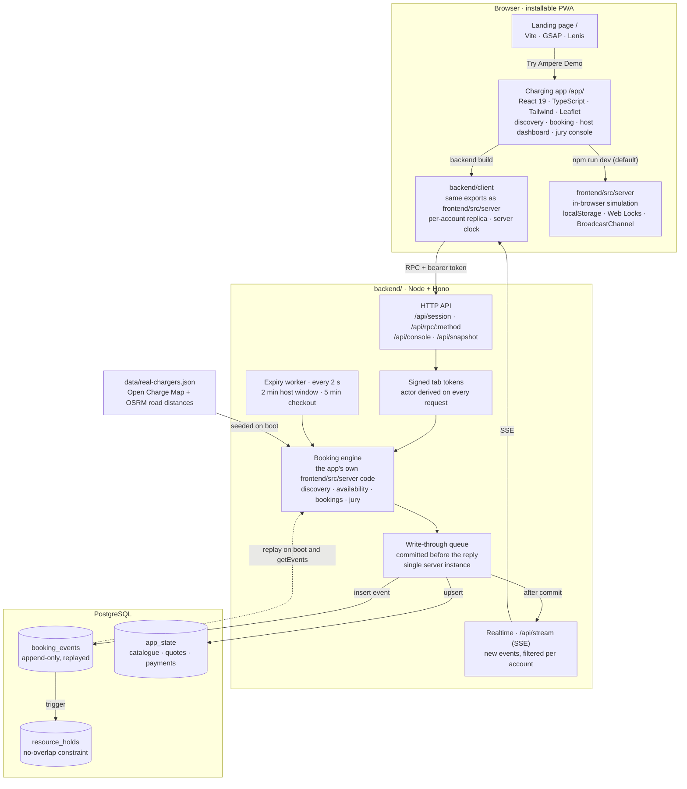
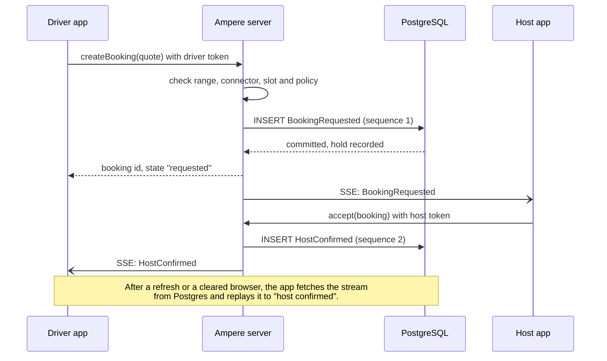

<div align="center">

#  Ampere

**One app to find EV charging.**

Find reachable, connector-compatible chargers around Pune and book community chargers hosted by cafés, offices and homes.

</div>


> **Demo only.** Listings are synthetic. Payments, refunds, metering, receipts and payouts are simulated. Ampere is a working name, with brand clearance pending.

## What is Ampere?

Ampere brings public EV charger discovery and private charger sharing into one application for India. A driver searches once, sees only the chargers their car can actually reach and plug into, compares access and price, and requests a confirmed slot. Hosts such as cafés, offices and homeowners offer their chargers through a managed journey.

The full product thinking lives in the [Ampere Product Solution Document](Ampere_Solution_Document.md).

## Demo

There is no hosted deployment yet. The demo runs from a laptop, and phones on the same Wi-Fi use the network address the server prints at startup.

| Link | What it opens |
| --- | --- |
| http://localhost:8787/ | Landing page, served by the backend (`cd backend && npm start`) |
| http://localhost:8787/app/ | Charging app, with bookings stored in PostgreSQL |
| http://localhost:8787/app/jury | Jury console (sign in as **Jury panel**) |
| http://localhost:5173/ | Browser-only version from `npm run dev`, used as the offline fallback |

The [quick demo walkthrough](#quick-demo-walkthrough) lists the accounts and steps.

## Repository layout

Ampere ships as a single web app: the landing page is served at `/` and the charging app at `/app/`, both from one Vite project and one dev server. A separate Node server in `backend/` can serve the same app against Postgres.

| Path | What it is | Stack |
| --- | --- | --- |
| [`/`](package.json) (`src/`, `index.html`, `public/`, `vite.config.js`) | Landing page with scroll animation and a phone-mockup hero. Its Vite config also mounts the charging app at `/app/` | Vite, GSAP, Lenis |
| [`frontend/`](frontend/README.md) | The charging app, an installable front-end PWA that opens from the landing page | React 19, TypeScript, Tailwind CSS 4, Leaflet, Vite, Vitest |
| [`backend/`](backend/README.md) | Server for the app: Postgres booking events, jury console, realtime, real public chargers | Node, Hono, PostgreSQL, Vitest |

## Tech stack

| Layer | Technology | Used for |
| --- | --- | --- |
| Landing page | Vite, GSAP, Lenis | Scroll animation and the phone-mockup hero |
| Charging app | React 19, TypeScript, React Router, Tailwind CSS 4, lucide-react | Driver, host, admin and jury screens |
| Maps | Leaflet, React Leaflet, OpenStreetMap tiles | Charger map and the range ring |
| Offline mode | vite-plugin-pwa (Workbox) | Installable app with a service worker |
| Server | Node 22+, Hono, `@hono/node-server`, TypeScript run with `tsx` | HTTP API, jury console, realtime (server-sent events), expiry worker |
| Database | PostgreSQL 15+ (17 used locally) through the `postgres` client | Append-only booking events, demo state, overlap-proof charger holds |
| Data | Open Charge Map (CC BY 4.0), OSRM | Real public chargers and their road distances |
| Tests | Vitest, TypeScript compiler | 64 app tests, 22 server tests, type checks |

## Architecture



The same React screens run in two modes. `npm run dev` at the root keeps everything in the browser: `frontend/src/server` simulates the server, database and realtime channel. The [`backend/`](backend/README.md) build swaps those modules at build time for network clients with the same exports, so the screens are unchanged while bookings, holds and the console move to the server.

On the server the booking rules are not rewritten. The engine is the app's own `frontend/src/server` code, kept in memory and written through to Postgres. Postgres enforces the core rules as well: booking events cannot be updated or deleted, each stream's sequence must be contiguous and start with `BookingRequested`, and an exclusion constraint on `resource_holds` refuses two overlapping holds on one charger.

### A booking request, end to end



The jury console takes the same path: `TICKET` calls the booking service that `createBooking` uses, and `READY` appends the same `HostConfirmed` event as the host's button.

## Key features (charging app)

- **Strict discovery.** Only chargers within the car's estimated road range *and* matching its connector are shown. The same rules drive the map, the list and the console.
- **Community booking.** Request a slot, host confirmation, demo checkout, arrival code, charging session and receipt.
- **Event-sourced bookings.** Each booking is an append-only event stream and its state is derived by replay. Five lifecycle labels are shown: requested, host confirmed, on the way, charging and done.
- **Live updates across devices.** Driver and host sessions stay in sync through server-sent events from the backend, or a simulated channel between tabs in the browser-only build.
- **Jury Console.** A plain-text console that accepts `TICKET` and `READY` commands and writes through the same booking services as the app.
- **Installable PWA** with a service worker.

By default everything runs in the browser: the server, database and realtime channel are simulated in `frontend/src/server/` using `localStorage`, Web Locks and a `BroadcastChannel`. The [`backend/`](backend/README.md) server runs the same app, unchanged, against PostgreSQL, so bookings persist across devices, cleared browsers and restarts.

## Getting started

One command from the repository root runs the whole product. The landing page and the charging app are served by the same Vite process on the same port, and the landing page's "Try Ampere Demo" buttons open the app (`/app/?demo=driver`).

```bash
npm install        # from the repository root; frontend/ dependencies are installed automatically on first run
npm run dev        # starts everything
```

| URL | What you get |
| --- | --- |
| http://localhost:5173/ | Landing page |
| http://localhost:5173/app/ | Charging app (hot reload) |

To check the production build, which writes the landing page to `dist/` and the app to `dist/app/`:

```bash
npm run build
npm run preview    # http://localhost:4173 (app at http://localhost:4173/app/)
```

### Working on the charging app alone

Only needed if you want the app on its own, served from `/`:

```bash
cd frontend
npm install
npm run dev        # http://localhost:5173
npm test           # domain and flow tests (vitest)
```

Stop the root dev server first, or pass `-- --port <n>`, because both use port 5173.

### Running with the backend (PostgreSQL)

Needs Node 22+ and PostgreSQL 15+ (Homebrew `postgresql@17` works).

```bash
createdb ampere
cd backend
npm install
npm run build:web  # landing page + server-backed app into ../dist
npm start          # http://localhost:8787, app at /app/
npm run reset      # in a second terminal: restore the demo data
npm test           # server tests (uses an ampere_test database)
```

The first start applies the migrations and seeds the demo. Later starts load everything from PostgreSQL. More detail is in the [server README](backend/README.md).

## Environment variables

The browser-only build (`npm run dev` at the root) needs no environment variables.

The backend reads these. Copy [`backend/example.env`](backend/example.env) to `backend/.env` or export them in your shell. Never commit `.env` or a real key.

| Variable | Default | Purpose |
| --- | --- | --- |
| `DATABASE_URL` | `postgres://localhost:5432/ampere` | PostgreSQL connection |
| `TOKEN_SECRET` | random per process | HMAC secret that signs session tokens. Set it for any shared deployment, or sessions end when the server restarts |
| `PORT` | `8787` | Server port |
| `CORS_ORIGIN` | localhost dev ports | Comma-separated origins allowed to call the API from another origin |
| `VITE_AMPERE_API_URL` | empty (same origin) | Build time: API address when the app is hosted separately from the server |
| `AMPERE_DEV_API` | `http://localhost:8787` | Where `npm run dev:web` proxies API calls |
| `AMPERE_URL` | `http://localhost:8787` | Server that `npm run reset` talks to |
| `OCM_API_KEY` | none | Only for `npm run import:chargers`. Free key from Open Charge Map |
| `IMPORT_RADIUS_KM`, `OSRM_URL` | `20`, public OSRM | Optional settings for the charger import |

## Quick demo walkthrough

1. Sign in as **Aarav**, a driver at MIT-WPU with a Nexon EV at 4% battery. Home shows a 4.0 km road budget.
2. Open **Stations**. Out-of-range or incompatible chargers are hidden, and only the hidden count is shown.
3. Open **Café Durga · demo**, choose 90 min, 8 kWh and the Standard plan. The demo total is ₹112 + ₹20 = **₹132**. Request the booking and choose who brings the cable.
4. In a second window (a private window or another device), sign in as **Rohan**, the café host, and confirm within 2 minutes. Cafés and offices belong to Rohan; residential societies belong to **Meera**.
5. Pay (demo), start the journey, show the arrival code, then start and complete the session as the host.
6. Sign in as *Jury panel* and open `/jury`:
   ```
   TICKET|Tata Nexon EV|4|18.5362|73.8939|CCS2
   READY|<printed ref>|<ISO time>
   ```
   Reload the page, or clear the browser's site data, and the booking is restored from the persisted event stream.

With the backend running, `cd backend && npm run reset` restores the demo data before a run.

See [`frontend/README.md`](frontend/README.md) for the architecture table and known limits.

## Honest limits

- Community listings are synthetic. The backend adds real public chargers from Open Charge Map as non-reservable directory listings.
- Map tiles come from the public OpenStreetMap tile server, which is suitable for demos only.
- Without the backend, data lives in the browser's storage, so tabs of one browser share it but separate devices do not.
- The 4% battery scenario demonstrates careful filtering. It is not a rescue guarantee.

## Team

Team Stochastic:

- Harsh Gidwani
- Soham Nigam
- Samarth Bolkotgi
- Aryan More

## Documentation

- [Ampere Product Solution Document](Ampere_Solution_Document.md): product, operating model, pricing assumptions and pilot plan.
- [Charging app README](frontend/README.md): run instructions, demo script and architecture.
- [Server README](backend/README.md): running the app against PostgreSQL, real charger data and the jury proof.
