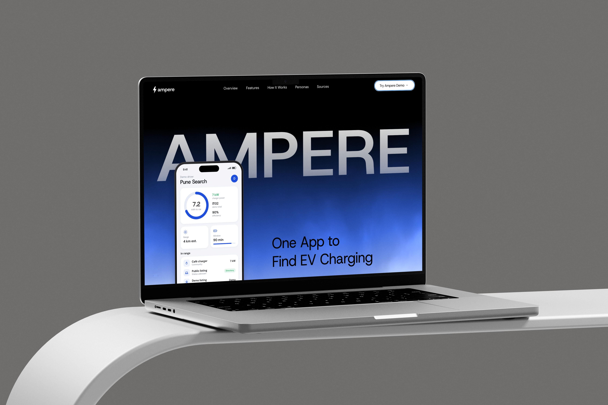
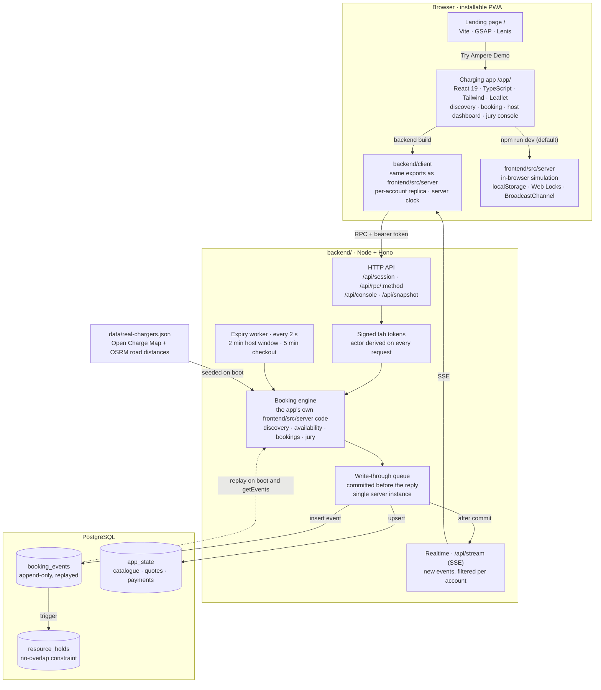
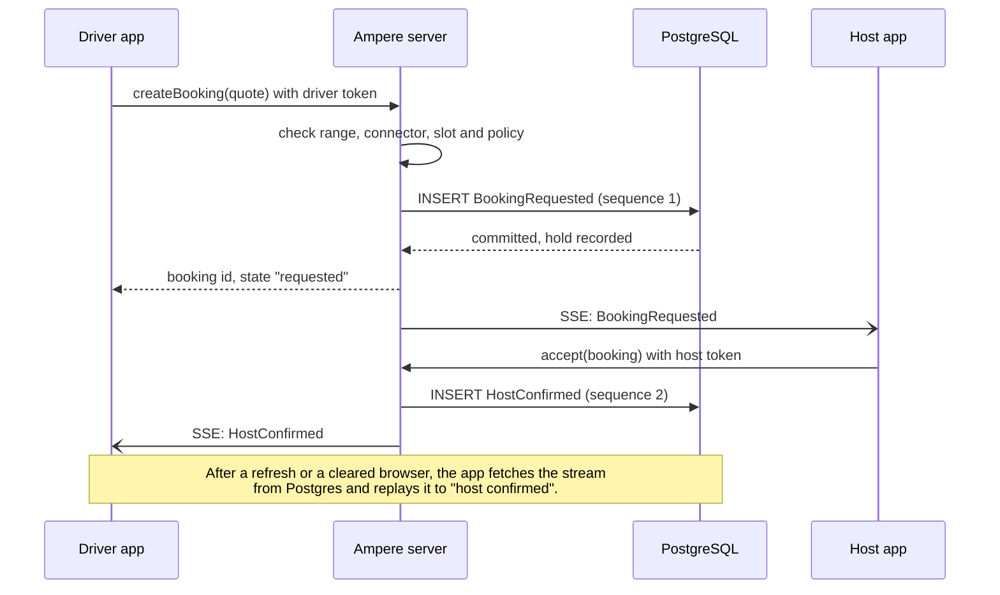

<div align="center">

#  Ampere

**One app to find EV charging.**

Find reachable, connector-compatible chargers around Pune and book community chargers hosted by cafés, offices and homes.

</div>



> **Demo only.** Listings are synthetic. Payments, refunds, metering, receipts and payouts are simulated. Ampere is a working name, with brand clearance pending.

## What is Ampere?

Ampere brings public EV charger discovery and private charger sharing into one application for India. A driver searches once, sees only the chargers their car can actually reach and plug into, compares access and price, and requests a confirmed slot. Hosts such as cafés, offices and homeowners offer their chargers through a managed journey.

The full product thinking lives in the [Ampere Product Solution Document](Ampere_Solution_Document.md).

## Repository layout

Ampere ships as a single web app: the landing page is served at `/` and the charging app at `/app/`, both from one Vite project and one dev server.

| Path | What it is | Stack |
| --- | --- | --- |
| [`/`](package.json) (`src/`, `index.html`, `public/`, `vite.config.js`) | Landing page with scroll animation and a phone-mockup hero. Its Vite config also mounts the charging app at `/app/` | Vite, GSAP, Lenis |
| [`frontend/`](frontend/README.md) | The charging app, an installable front-end PWA that opens from the landing page | React 19, TypeScript, Tailwind CSS 4, Leaflet, Vite, Vitest |

## Architecture



The same React screens run in two modes. `npm run dev` at the root keeps everything in the browser: `frontend/src/server` simulates the server, database and realtime channel. The `backend/` build swaps those modules at build time for network clients with the same exports, so the screens are unchanged while bookings, holds and the console move to the server.

On the server the booking rules are not rewritten. The engine is the app's own `frontend/src/server` code, kept in memory and written through to Postgres. Postgres enforces the core rules as well: booking events cannot be updated or deleted, each stream's sequence must be contiguous and start with `BookingRequested`, and an exclusion constraint on `resource_holds` refuses two overlapping holds on one charger.

### A booking request, end to end



The jury console takes the same path: `TICKET` calls the booking service that `createBooking` uses, and `READY` appends the same `HostConfirmed` event as the host's button.

## Key features (charging app)

- **Strict discovery.** Only chargers within the car's estimated road range *and* matching its connector are shown. The same rules drive the map, the list and the console.
- **Community booking.** Request a slot, host confirmation, demo checkout, arrival code, charging session and receipt.
- **Event-sourced bookings.** Each booking is an append-only event stream and its state is derived by replay. Five lifecycle labels are shown: requested, host confirmed, on the way, charging and done.
- **Live updates across tabs.** Driver and host sessions stay in sync through a simulated realtime channel.
- **Jury Console.** A plain-text console that accepts `TICKET` and `READY` commands and writes through the same booking services as the app.
- **Installable PWA** with a service worker.

Everything runs in the browser. The server, database and realtime channel are simulated in `frontend/src/server/` using `localStorage`, Web Locks and a `BroadcastChannel`.

## Getting started

One command from the repository root runs the whole product. The landing page and the charging app are served by the same Vite process on the same port, and the landing page's "Try Ampere Demo" buttons open the app (`/app/?demo=driver`).

```bash
npm install        # from the repository root; frontend/ dependencies are installed automatically on first run
npm run dev        # starts everything
```

| URL | What you get |
| --- | --- |
| http://localhost:5173/ | Landing page |
| http://localhost:5173/app/ | Charging app (hot reload) |

To check the production build, which writes the landing page to `dist/` and the app to `dist/app/`:

```bash
npm run build
npm run preview    # http://localhost:4173 (app at http://localhost:4173/app/)
```

### Working on the charging app alone

Only needed if you want the app on its own, served from `/`:

```bash
cd frontend
npm install
npm run dev        # http://localhost:5173
npm test           # domain and flow tests (vitest)
```

Stop the root dev server first, or pass `-- --port <n>`, because both use port 5173.

## Quick demo walkthrough

1. Sign in as **Aarav**, a driver with a Nexon EV at 4% battery. Home shows a 4.0 km road budget.
2. Open **Stations**. Out-of-range or incompatible chargers are hidden, and only the hidden count is shown.
3. Open **Ember & Ohm Café**, choose 90 min and 8 kWh. The demo total is ₹112 + ₹20 = **₹132**. Send the request.
4. In a second tab, sign in as **Rohan**, the café host, and confirm.
5. Pay (demo), start the journey, show the arrival code, then start and complete the session as the host.
6. Sign in as *Jury panel* and open `/jury`:
   ```
   TICKET|Tata Nexon EV|4|18.5362|73.8939|CCS2
   READY|<printed ref>|<ISO time>
   ```
   Reload the page and the booking is restored from the persisted event stream.

See [`frontend/README.md`](frontend/README.md) for the architecture table and known limits.

## Honest limits

- Synthetic listings only. Real-world verified records are not yet included.
- Map tiles come from the public OpenStreetMap tile server, which is suitable for demos only.
- Data lives in the browser's storage, so tabs of one browser share it but separate devices do not.
- The 4% battery scenario demonstrates careful filtering. It is not a rescue guarantee.

## Documentation

- [Ampere Product Solution Document](Ampere_Solution_Document.md): product, operating model, pricing assumptions and pilot plan.
- [Charging app README](frontend/README.md): run instructions, demo script and architecture.
